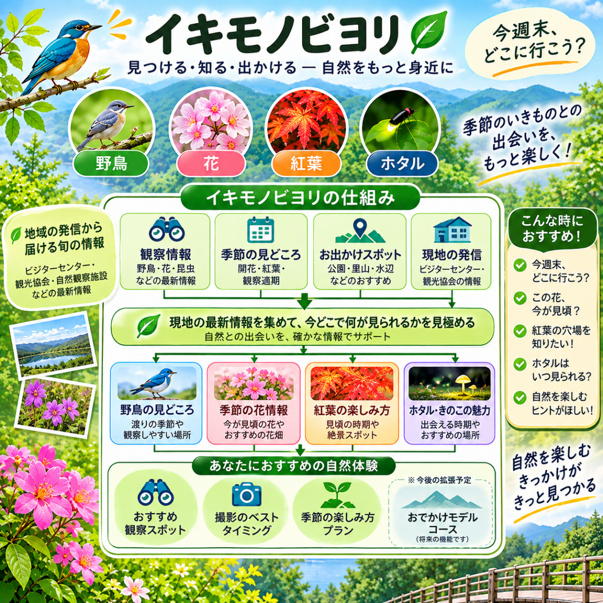

# イキモノビヨリ (ikimonobiyori)

紅葉・花・野鳥・高山植物などの「今週末どこへ行くとよいか」「いつごろ・どこで見られるか」を、公開されている情報から下調べして答える、ネイチャーガイド役のツールです(版 0.2.0。変更の記録は [`CHANGELOG.md`](CHANGELOG.md))。
公式ページから読んだ今の様子、主催者の行事・観察会、iNaturalist の過去の観察記録の集計、気象庁の観測値から計算した平年の目安、出典つきの知識カードを、コードが「資料」にまとめ、Claude Code の会話(スキル `ikimono-weekend`)で AI がガイドとして答えを書き、コードが事実を照らしてから送ります。
出発地は既定で横浜(東京・大宮など、質問で変えられます)で、地域の指定がなければ出発地から片道 250 km 前後の、登録済みの名所の全範囲から探します。
個人・非商用の下調べのためのツールです。〇〇ビヨリ(ヤマビヨリ・ホシビヨリなど)の仲間で、共通の契約 `biyori-proposal/1`(提案)も出力します。



図の中の「おでかけモデルコース」は今後の予定で、まだありません。

## 何ができるか

| 質問の例 | 答えの内容 |
|---|---|
| 「今の見頃のものを教えて」「今週末、冬鳥を見に行きたい」「今週末の紅葉の情報は?」 | 今の季節に見られるもの・行き先の候補(公式の今の様子は日付つき、なければ例年の目安)と、なぜ今見られるのか・どこをどう見るか |
| 「高尾山の見どころを教えて」「袋田の滝の見どころは?」「南伊豆で見られる花は?」 | 名指しした場所・市区町村の名所の今の様子・例年の時期・行事・行く前の注意と、その場所の話 |
| 「梅はいつどこで見られる?」「2月の週末、梅を見たい」「白鳥を見たい」 | 種の名所と例年の時期(日付を決めた質問は、その日に当たる名所)・数が多い時期 |
| 「苔を見に行きたい」「今の時期に見られるチョウやトンボは?」 | テーマの話のカードと、例年この時期の観察記録の傾向 |
| 「来月、梅やロウバイの行事はある?」「今週末の観察会やまつりは?」 | 主催者が決めた行事・観察会・まつりの期間(色づき・咲き具合とは別に書く) |
| 「チングルマはいつ見られる?」「丹沢で見られる野草は?」 | 高山植物・野草の例年の花期(山域・地点・種の名前で) |
| 「ジョウビタキとはどんな鳥?」「オオハクチョウとコハクチョウの違いは?」 | 知識カード(出典つき)にある特徴・見分け方 |
| 「写真つきのページにして」「artifactにして」 | 直前の答えと同じ内容の、種の代表写真つきの HTML ページ(出典は URL つき) |
| 「出典を見せて」「URL を教えて」 | 直前の答えの、URL つきの出典の一覧 |

- 今年の様子は、現地の公式な発信(自治体・観光協会・公園や施設の管理者・ビジターセンター)を主にします。公式でない情報や古い情報も、答えを止める理由にはせず、出所と日付を添えて確かさとして示します(現況の日付が対象の日より 7 日以上前なら「その後の発表は確かめられていません」と書きます)。
- 古い年の記事・SNS の投稿は根拠にしません。気象会社の見頃予想(ウェザーニュース・tenki.jp・日本気象協会など)は、転載を含めて使いません。
- 野鳥の位置は粗く丸め(既定は小数 1 桁)、正確な座標・観察者は保存も出力もしません。答えには観察のマナーを添えます。

## 仕組みの概要

コードが事実を集めて「資料」を作り、AI がガイドとして答えを書き、コードが答えの事実を資料と照らします(ガイドの形。これが既定で、`ikimonobiyori/data/ask/guide_mode.yaml` の `answer_form: guide`)。手順は [`docs/guide-mode.md`](docs/guide-mode.md)、書き方は [`docs/guide-voice.md`](docs/guide-voice.md) にあります。

1. **資料を作る**(`ask brief "<質問>"`): 候補と順位・確かめた事実(今年の現況・例年の目安・行事・施設の情報)・知識カード・語りの材料・例年この時期の観察記録・足りないもの・決まり。続けて聞く質問は `--prev <前の資料の id>`。
   - **現況の自動の読み直し**: 資料に入る候補の、台帳で承認済みの現況のページと、承認済みの施設(ビジターセンターなど)の情報ページのうち、有効期間(現況・野鳥 24 時間、施設 48 時間)を過ぎたものを、候補の順位の高いものから 1 問 5 ページ・25 秒・通信 12 回まで読み直します。日光市観光協会・箱根町観光協会のページはコードが状態を読みます。ほかのページは本文から状態を推し量らず、前回の記録の原文がそのまま残っていれば読んだ時刻だけを更新し、変わっていれば本文の控えを資料に出して、AI が確かめて記録してから資料を作り直します。読めないとき(オフラインなど)は古い記録のまま作り、そのことを資料に書きます。
   - **資料が薄いときにその場で調べる**: 聞かれた種の名所が少ない・聞かれた場所の記録がないとき、資料に「調べる」の節が出ます。AI が公式ページの URL を探し、`ask research fetch <URL> --brief <id>` で本文を読み(1 問 3 ページ・2 分まで。robots.txt を先に読む)、確かめた名所と例年の時期だけを `ask research record` で記録します(今年の現況は記録しません)。
2. **AI が書く**: 資料と `docs/guide-voice.md` だけで下書きを書きます(Web やほかのコマンドで事実を足しません)。確かめた事実を使う文には資料の印(`[F012]`・`[K034]`・`[O001]`)を付けます。
3. **照らす**(`ask verify <下書き> --brief <id>`): 今年の現況・日付・行事の期間・開園時間・料金・電話・距離・範囲外の地名・種の特徴などを資料と照らします。合格なら、印を取り除いて出典の行を付けた、送る文だけを出します。不合格は理由と直し方を出し、2 回まで書き直します。3 回目は骨組みの形の答えを出します。

骨組みの形(`ask answer`。事実の入った骨組みをコードが作り、言い回しだけを整える今までの形)は、単体の実行・表にして比べる答え・ガイドの形の控えとして残っています。`answer_form: classic` で既定に戻せます。

### 確かさの 3 段

| 段 | 答えでの書き方 | 材料 |
|---|---|---|
| 公式で確認 | 「11月9日時点、長瀞町観光協会の発表では見頃を迎え始めています」 | 今年の現況の事実(日付つき) |
| 例年の目安 | 「例年は11月中旬から下旬が見頃です」 | 例年の目安の事実・カード |
| 一般的な知識 | 「カエデは寒暖差が大きいほど赤が濃くなります」 | 季節・環境の説明だけ |

- **種の見分け方・特徴**(花や葉の形・色・大きさ・くちばしや羽・鳴き声・似た種との違いなど)は、知識カードにあることだけを書き、カードの印を付けます。カードがなければ書きません(`ask verify` が照らします)。

### 語りの材料

- **例年この時期の観察記録**: iNaturalist の過去 5 年の観察記録を、地域の組(東京・神奈川/埼玉・千葉・茨城/栃木・群馬/山梨・長野/静岡/新潟・福島)× 週 × 分類(野鳥・野生の植物・虫〔トンボ・チョウ・そのほか〕・きのこ・そのほかの動物)で数えたものです(`ikimonobiyori/seasonal_obs.py`。値は `ikimonobiyori/data/observations/seasonal.yaml`)。答えでは今年の状態としてではなく、過去の記録の傾向として書きます。
- **知識カード**: その場所の話(場所の目玉)・その種の話(特徴・見分け方)・一般の話(テーマ)・**季節の暦**(環境と月ごとの見どころ)・**小話**(名前の由来や言い伝え)。出典つきで、データ置き場に置きます(下の「公開しないもの」)。
- 資料には、紅葉や野鳥の候補がある質問でも、観察記録を 1〜2 点と季節の暦を 1 点、先に入れます。

### 出典

- 会話の答えの出典は、名前と日付だけの 1 行です(例: 「出典: 日光市観光協会(11/14時点)、長瀞町観光協会(11/9時点)、高尾ビジターセンター(11/6時点)」。紹介サイトと分かるものだけ「紹介サイト」と添え、多いときは「ほか○件」)。
- URL つきの出典は、`python -X utf8 -m ikimonobiyori.ask source-urls` が直前の答えから出します(「出典を見せて」「URL を教えて」と言われたとき)。写真つきのページには URL つきの出典が入ります。

### 写真と写真つきのページ

- 写真は「種の代表写真」です(その場所で撮られた写真ではありません)。iNaturalist の写真のうちライセンスが CC0・CC BY・CC BY-SA のもの、なければ Wikimedia Commons の CC0・CC BY・CC BY-SA・パブリックドメインで作者の表記があるものを使い、撮影者とライセンスを添えます。写真はデータ置き場に置き、リポジトリには入れません。
- 写真は点検します(`ask photo-review list|set --name <和名> --verdict ok|ng`)。生きた姿でないもの・人の手が大きく写るもの・花の種なのに花がないものなどは使いません。会話で写真を指摘されたときの直し方は `docs/guide-mode.md` にあります。
- ページを頼まれたときは、合格した答えから `ask page` でページを作り、公開したら `ask page-reply --url <リンク>` の決まった案内の文を送ります。

### 送る前の検査

- **Claude Code**: Stop フック(`.claude/settings.json` → `.claude/hooks/stop_check.py` → `ikimonobiyori/stop_hook.py`)が、送る前の検査を強制します。`ask verify` を通していない答え・`ask verify` の出した文と違う文(前置きや作業の説明を足したものを含む)・道具を使わない生き物の答え・手で書き写した出典の URL は、送る前に止めて手順を案内します。ページの案内(`ask page-reply`)・出典の一覧(`ask source-urls`)・写真を直したあとの文(`ask photo-reply`)は、その出力と一致するときだけ通します(空白・改行・リンクの書き方の違いは見ません)。
- **フックのない環境**(Codex・ほかのエージェント): [`docs/guide-mode.md`](docs/guide-mode.md) §4 の手順を守ります(貼るだけで使える依頼文もあります)。
- 答えの手順の全体は [`CLAUDE.md`](CLAUDE.md)(Codex 向けは同じ内容の [`AGENTS.md`](AGENTS.md))と、スキル [`.claude/skills/ikimono-weekend/SKILL.md`](.claude/skills/ikimono-weekend/SKILL.md) にあります。

### 計算による判定(v0)と契約

- `ikimonobiyori/main.py` は、依頼 `biyori-request/1` から契約 `biyori-proposal/1` の提案を作ります。v0 の計算の手法があるのは紅葉と野鳥です(桜・彼岸花・ひまわり・ホタル・夜光虫・花・冬鳥のプロファイルは骨組みで、`not_applicable: profile_skeleton` を返します)。
  - 紅葉: Open-Meteo の日最低気温から段階を決める(`temperature_progression`)。気象庁の生物季節観測との答え合わせは不合格だったため([`docs/stage14-result.md`](docs/stage14-result.md))、現況がない名所の補助の推定にとどめます。
  - 野鳥: iNaturalist の観察記録の集計から、種ごとの相対頻度(0〜1)を出す(`observation_frequency`)。
- 判定はすべて未検証(`validated: false`)で、`band` の上限は `maybe`(`go` は出しません)。確信度の数値は出力しません(`null`)。点数は他のビヨリの点数と比べません。
- 閾値・係数・窓・年数はプロファイル(`ikimonobiyori/profiles/*.yaml` の `method.params`)と方針の YAML にだけ書き、コードに直接書きません(テストが検査します)。時刻は ISO 8601(オフセットつき)、欠損は `null`、同じ入力・同じ `--now` なら同じ出力です。

## データの出どころと利用条件

記録の詳細は [`docs/data-sources.md`](docs/data-sources.md) にあります。

- **Open-Meteo**(紅葉の気温): 無料 API は非商用のみ(1 日 10,000 call)。データは CC BY 4.0。帰属表示:
  *Weather data by [Open-Meteo.com](https://open-meteo.com/), licensed under [CC BY 4.0](https://creativecommons.org/licenses/by/4.0/)*
  (`tests/fixtures/recorded_open_meteo_2026-10-14.json` は 2026-10-14 に取得した実際の応答の記録で、同じ帰属を付けています)。
- **iNaturalist**(野鳥の観察記録の集計・例年この時期の観察記録の集計・種の祖先の分類・種の代表写真): 利用規約・API の推奨手順は**ユーザー確認済み(2026-10-21、data-sources.md の記録)**(`docs/data-sources.md` §3)。保存・出力するのは集計値(種ごとの件数・分類名・開花の注釈の件数)だけで、学習には使いません。実際の応答はリポジトリに置かず、テストは合成データで行います。写真は上の「写真と写真つきのページ」のとおりです。
- **Wikimedia Commons**(iNaturalist に写真がない種の代表写真): CC0・CC BY・CC BY-SA・パブリックドメインで作者の表記があるものだけ。
- **気象庁 生物季節観測**(平年の目安・紅葉の答え合わせ): 出典:気象庁ホームページ「生物季節観測累年値」(https://www.data.jma.go.jp/sakura/data/download_ruinenchi.html)。公共データ利用規約(第1.0版)(https://www.digital.go.jp/resources/open_data/public_data_license_v1.0)に従い、出典と加工したことを明記しています。平年の目安(`ikimonobiyori/data/jma_normals/normals.yaml`)は、気象庁の観測値をもとにイキモノビヨリが平均等を計算したもので、気象庁が作成した値(平年値)ではありません。
- **環境省・生物多様性センター・自治体などの公的資料**: 公開ページの事実を、出典つき・自分の言葉で知識カードにしています。カードごとに権利の確認のメモを持ち、確認済みのもの(都県・市区町村のページで規約の記載がないものを含む)だけを答えに使います。
- **各公式サイト**(自治体・観光協会・公園や施設の管理者・ビジターセンター・博物館など): 答えるとき(と現況の自動の読み直し・その場で調べるとき)に読み、状態の短い原文・日付・例年の時期・URL だけを記録します。定期的な巡回はせず、robots.txt や応答で自動アクセスを拒むページは読みません(人が開く URL として示します)。利用条件はページごとに確かめ、台帳に残しています。
- **地点カタログ**(`ikimonobiyori/data/sites.yaml`): [yamabiyori](https://github.com/ktakemaru/yamabiyori)(MIT)の山リスト(`MOUNTAINS`、commit `de66f10`)を一度だけ複製したもの。複製元は `copied_from` に記録しています。

### 公開しないもの

知識カード(`knowledge/cards.jsonl`)と発行物台帳(`knowledge/publications.jsonl`。メタデータとハッシュだけ)は、リポジトリの外のデータ置き場(`IKIMONOBIYORI_DATA_DIR` の下)に置き、このリポジトリには含めません。出典ごとに転載・複製の条件が違い、公開してよいか確かめきれないものがあるためです。バックアップは別の非公開リポジトリに commit します(`ask knowledge backup`。push は本人。[`docs/operations.md`](docs/operations.md) §2-4)。実行で作る記録・キャッシュ・写真・ページ・資料・読み直した本文の控えも同じ置き場に書きます。

## 情報源の承認

- 公式の情報源(現況の台帳 `ikimonobiyori/data/sources/`、ビジターセンターの台帳 `ikimonobiyori/data/visitor_centers/`、行事の台帳 `ikimonobiyori/data/facility_events/`)は、**利用者が承認したもの**を公式の現況・行事として答えに使います。承認待ちの施設の発信・行事は答えに出ません。施設ごとの条件(種名は使わない など。台帳の `allowed_fields`)は、記録のときにコードが守ります。
- 承認の判断は利用者が行います。手順は [`docs/operations.md`](docs/operations.md) §2、判断の材料は [`docs/sources-approval.md`](docs/sources-approval.md)・[`docs/sources-approval-61.md`](docs/sources-approval-61.md) にあります。
- 紹介サイト(ウォーカープラスなど)は別の台帳(`ikimonobiyori/data/sources/secondary/`)に置き、答えでは「紹介サイトによると」と添える参考にとどめます。

## 使い方

Python 3.13 で確認しています。依存は `requirements.txt`(PyYAML・jsonschema・requests・pdfminer.six と、それらの依存。版は固定)です。

```
python -m pip install -r requirements.txt
```

### 会話で使う

このリポジトリを開いた Claude Code で、「今週末の紅葉の情報は?」「今週末、冬鳥を見に行きたい」のように聞くと、スキル `ikimono-weekend` の手順で答えます。コマンドを直接使うときの入口は次のとおりです。

```
python -X utf8 -m ikimonobiyori.ask brief "今週末の紅葉の情報は?"    # 資料を作る(標準出力は資料の id とファイルの場所)
python -X utf8 -m ikimonobiyori.ask verify <下書き> --brief <id>      # 下書きを資料と照らす(合格なら送る文だけを出す)
python -X utf8 -m ikimonobiyori.ask source-urls                     # 直前の答えの URL つきの出典
python -X utf8 -m ikimonobiyori.ask answer --question "<質問>"        # 骨組みの形の答え(単体の実行・控え)
python -X utf8 -m ikimonobiyori.ask audit                           # 取りこぼしの点検(通信しない。記録にある名所のうち資料に入らなかったものを理由ごとに数える)
python -X utf8 -m ikimonobiyori.ask -h                              # そのほかの手順(warm・record・vc-record・research・page・photo-review など)
python -X utf8 -m ikimonobiyori.guide -h                            # 名所のガイド・野草と高山植物(wildflower)・写真の取得(photos-ensure など)
python -X utf8 -m ikimonobiyori.seasonal_obs -h                     # 例年この時期の観察記録の集計(status・fetch・taxa・window)
```

### 提案(`biyori-proposal/1`)を作る

```
# オフライン(入力 JSON = ikimono-inputs/1。tests/fixtures/synthetic_inputs.json は合成)
python -X utf8 ikimonobiyori/main.py --request REQ.json --inputs tests/fixtures/synthetic_inputs.json --now 2026-10-14T22:00:00+09:00

# 問い合わせの一覧(通信なし)
python -X utf8 ikimonobiyori/main.py --request REQ.json --plan-queries --now 2026-10-14T22:00:00+09:00

# キャッシュだけから(通信しない)
python -X utf8 ikimonobiyori/main.py --request REQ.json --cache-only --now 2026-10-14T22:00:00+09:00
```

`REQ.json` は依頼 `biyori-request/1`(`interests` に `autumn_leaves` か `birds`)。`--now` は必須(オフセットつき)です。

### 書き込み先

記録・キャッシュ・資料・作業フォルダは、環境変数 **`IKIMONOBIYORI_DATA_DIR`** の下に書きます。未設定のときは、Windows は `%LOCALAPPDATA%\ikimonobiyori`、それ以外は `~/.local/share/ikimonobiyori` です。リポジトリの中(`ikimonobiyori/` を含む)には書きません。

### 実通信の制限

- **Open-Meteo などの実通信(`--live`)は、このリポジトリ単独では実行できません。** 環境変数 `BIYORI_ALLOW_LIVE=1`、明示的な `--max-requests`、そして通信の記録・上限・許可ホストを強制する**計測フック**(環境変数 `BIYORI_REQ_LOG`。biyori-hub の `hub/measure/`)が要ります。許可ホストは `ikimonobiyori/config.yaml` の `live.allowed_hosts_by_subject` だけです。
- 単体で取りに行くものは、イキモノビヨリ自身の上限(`ikimonobiyori/netbudget.py`)の下で、同じホストへの間隔をあけ、実行ごとの記録を `IKIMONOBIYORI_DATA_DIR` の下の `netlog/requests.jsonl` に残します。

| 取りに行くもの | 1 回の上限 | 間隔 | 値の場所 |
|---|---|---|---|
| iNaturalist の野鳥の集計(質問のとき) | 1 問 10 リクエスト | 1 秒以上 | `data/observations/policy.yaml` の `inat_refresh` |
| 種の代表写真(iNaturalist) | 1 回の実行 80 リクエスト | 1 秒以上 | `data/guide/policy.yaml` の `photos` |
| 種の代表写真(Wikimedia Commons) | 1 回の実行 60 リクエスト | 6 秒 | `data/guide/policy.yaml` の `photos.commons` |
| 例年この時期の観察記録の集計(`seasonal_obs fetch`・`taxa`) | 1 回の実行 60 リクエスト | 1.5 秒 | `data/observations/seasonal.yaml` |
| 現況の自動の読み直し(`ask brief`) | 1 問 5 ページ・25 秒・12 リクエスト | 1 秒以上 | `data/ask/guide_mode.yaml` の `auto_refresh` |
| その場で調べる(`ask research fetch`) | 1 問 3 ページ・2 分 | 1 秒以上 | `data/ask/guide_mode.yaml` の `research` |

- 直接のコマンド(`guide photos-*`・`seasonal_obs fetch`・`seasonal_obs taxa` など)は `BIYORI_ALLOW_LIVE=1`・`--live`・`--max-requests` が要ります。
- `BIYORI_UNDER_TEST=1`(テスト中)なら、実通信は常に拒否します。

## ビヨリコンシェルとの関係

[biyori-hub](https://github.com/ktakemaru/biyori-hub) は 2026-11-15 に開発を中止しました。山・星・生き物を合わせて答える役割は、ビヨリコンシェル(biyori-concierge)に移りました。

- ビヨリコンシェルは、このリポジトリを取り込まず(固定 commit の取り込み・`vendor.lock` はしません)、手元にある版をそのまま呼びます。入口は `python -X utf8 -m ikimonobiyori.ask brief "<質問>"` と `python -X utf8 -m ikimonobiyori.guide wildflower --site mNNN --month <月> --json` です。コンシェルが読むのは資料で、イキモノビヨリが仕上げた文(`ask verify` の出力)ではありません。
- 契約 `biyori-proposal/1` と語彙の正本は、ビヨリコンシェルの `schemas/` にあります。このリポジトリでは変えません。`tests/contract/biyori-proposal.schema.json` は検査用の写しです(`tests/contract/README.md`)。2026-11-27 に、ビヨリコンシェルの `schemas/biyori-proposal.schema.json` と同じ中身であることを確かめました。
- イキモノビヨリは単体で動きます(ビヨリコンシェルが無くても答えられます)。`ikimonobiyori/` は自分のフォルダの外を指さず、biyori-hub のモジュールを import しません(`tests/test_self_contained.py` が検査します)。
- 単体で聞かれてもビヨリコンシェルから呼ばれても、同じコマンド・同じ書き込み先(`IKIMONOBIYORI_DATA_DIR`)を使います。

biyori-hub のために作ったもので、今も残しているもの(消していません):

| もの | 扱い |
|---|---|
| `biyori-proposal/1` の提案の出力(`sources proposals` など)と `tests/contract/` | 残している理由: 出力の契約の決まり(`AGENTS.md` の絶対ルール 4)と、ゴールデンを含むテストがこの形を守っているため。ビヨリコンシェルは資料(`ask brief`)を読むので、この出力は使いません |
| 計測フック(`BIYORI_REQ_LOG`。biyori-hub の `hub/measure/`)の前提 | 残している理由: Open-Meteo などの `--live` の決まりを緩めないため(上の「実通信の制限」) |
| `ikimonobiyori/livegate.py`(実通信の許可の判定) | 残している理由: 単体の実行でも、実通信の許可をこの判定で決めるため。biyori-hub の `hub/livegate.py` と同じ判定として作りました |
| `ikimonobiyori/config.yaml` の `live.user_agent` の値(`biyori-hub/ikimonobiyori …`) | 残している理由: 通信の動きに関わる値なので、この作業では変えていません |
| ハブの manifest への値の写し(`phenology_labels`・`stage_order`・`ttl_s`) | 使っていません(manifest は biyori-hub の側にありました) |
| 窓口との統合のテスト・iNaturalist の実際の応答の記録 | 使っていません(biyori-hub の側にありました) |

## テストと CI

```
python -X utf8 -m unittest discover -s tests     # 全テスト
python -X utf8 -m ikimonobiyori.regress          # 回帰テスト(実際の質問の形で、答えの経路が期待どおりか)
```

- テストは通信しません(ソケットは `tests/nonet.py` で禁止、子プロセスも `tests/nonet_child/` で禁止)。テストごとの所要時間は `python -X utf8 tools/slow_tests.py` で測れます。
- GitHub Actions([`.github/workflows/ci.yml`](.github/workflows/ci.yml))が、push と pull request のときに Ubuntu 24.04 と Windows で Python 3.13 の同じテストを実行します(`BIYORI_UNDER_TEST=1`。実通信はしません)。
- ゴールデン(`tests/fixtures/golden/`)は、出力が変わっていないことを確かめます。

## ファイル構成

- `ikimonobiyori/` パッケージ
  - ガイドの形: `guide_brief.py`(資料)・`guide_verify.py`(照らす)・`guide_materials.py`(種の名所・距離・出典の名前)・`guide_narrative.py`(語りの材料)・`guide_answer_page.py`(写真つきのページ・ページの案内)・`auto_refresh.py`(現況の自動の読み直し)・`research.py`(その場で調べる)・`seasonal_obs.py`(例年この時期の観察記録)・`sources_reply.py`(URL つきの出典)・`stop_hook.py`・`final_check.py`(送る前の検査)・`audit.py`(取りこぼしの点検)・`gaps.py`(足りなかったことの記録)・`species_alias.py`(種の名前の読み替え)
  - 骨組みの形と共通の材料: `ask.py`(質問に答える手順の CLI)・`answer_run.py`(一発の答え)・`answer_plan.py`(計画)・`skeleton.py`(骨組み)・`polish.py`・`ask_verify.py`(整えの一致検査・答えの検査)・`observations.py`(読んだ事実の記録と答えの材料)・`page_cache.py`(読んだ時刻)・`season_place.py`(種の名所と例年の時期)・`highlights.py`(場所の見どころ)・`knowledge.py`(知識カード)・`visitor_centers.py`・`facility_events.py`・`festivals.py`(施設の発信・行事・まつり)・`jma_normals.py`(平年の目安)・`warm.py`(今日の準備)
  - ガイド型・写真: `guide.py`(ガイドの名所・写真の取得)・`guide_page.py`・`guide_photos.py`・`photo_pool.py`(写真と点検)・`wildflower.py`・`wildflower_species.py`・`wildflower_page.py`(野草・高山植物)
  - 計算による提案: `engine.py`(依頼 + 入力 + プロファイル → 提案)・`methods/`(手法)・`fetch/`(パーサー・キャッシュ・取得層。`status_pages.py` は日光市観光協会・箱根町観光協会のページを決まった形で読む)・`compose.py`(紅葉と野鳥の部品の合成)・`main.py`(CLI)
  - `profiles/` 対象ごとのプロファイル、`data/` 名所カタログ・台帳・方針の YAML(答えの決まりは `data/ask/`)、`config.yaml` 取得層の運用値、`schemas/` スキーマ、`paths.py` ファイルの場所、`livegate.py` 実通信の許可の判定、`netbudget.py` 単体での通信の上限
- `.claude/` Claude Code のスキル(`skills/ikimono-weekend/`)と Stop フック(`settings.json`・`hooks/stop_check.py`)
- `data/jma_phenology/` 気象庁 生物季節観測の累年値の CSV(取得したままのもの)と、並べ替えた `normalized.csv`。紅葉の答え合わせに使う([`data/jma_phenology/README.md`](data/jma_phenology/README.md))
- `docs/` 設計と調査の記録(段階ごとの指示書・報告書を含む。biyori-hub の中にあったときの記述が残ります)
  - [`docs/guide-mode.md`](docs/guide-mode.md) ガイドの形の手順(Claude Code・フックのない環境・その場で調べる・写真の指摘)
  - [`docs/guide-voice.md`](docs/guide-voice.md) ガイドの書き方(確かさの 3 段・印・語りの材料)
  - [`docs/design.md`](docs/design.md) 設計(役割の分担・時期の型・対象別の仕様・名所カタログ・検証方針)
  - [`docs/data-sources.md`](docs/data-sources.md) データ源ごとの使いみち・取り方・利用条件・出典表示
  - [`docs/operations.md`](docs/operations.md) 運用手順(指示書の渡し方・台帳の承認・知識カードのバックアップ・取りこぼしの点検)
  - [`docs/ask-rubric.md`](docs/ask-rubric.md) 答えの評価表
  - [`docs/proposal-mapping.md`](docs/proposal-mapping.md) 記録から提案 `biyori-proposal/1` への対応
  - [`docs/validation-plan.md`](docs/validation-plan.md)・[`docs/stage14-result.md`](docs/stage14-result.md) 紅葉の答え合わせの計画と結果
  - [`docs/how-to-add-spot.md`](docs/how-to-add-spot.md) 名所の足し方
- `tests/` テスト。`tests/fixtures/` は合成データ・Open-Meteo の記録・ゴールデン(`golden/`)、`tests/contract/` は契約の写し
- `tools/slow_tests.py` テストの所要時間の計測

## ライセンス

[MIT](LICENSE)。データの出典は上記のとおり(Open-Meteo は CC BY 4.0、iNaturalist の利用条件はユーザー確認済み〔2026-10-21〕、気象庁のデータは公共データ利用規約(第1.0版)で加工を明記、写真は撮影者とライセンスを添えて表示)。
